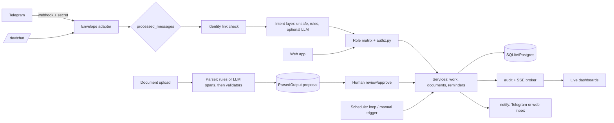

# School Operations Agent Platform

Registrations, role-aware access, document ingestion, intent routing, Telegram workflows, policy-aware
reminders, live dashboards and an audit trail, in a small FastAPI codebase a junior can extend.

> **AI disclosure:** built with AI assistance (Claude) as permitted by the assignment. No starter repo or template was used.

## Quick start (local)
```bash
python3 -m venv .venv && source .venv/bin/activate
pip install -r requirements.txt
cp .env.example .env           # set SESSION_SECRET; everything else is optional
uvicorn app.main:app --reload  # http://localhost:8000
pytest -q                      # all tests
```
No Telegram token or LLM key is needed to demo: use the built-in **/dev/chat** channel (same pipeline as Telegram).

### Telegram (live bot)
1. Create a bot with @BotFather, put the token in `.env` (`TELEGRAM_BOT_TOKEN`), set a long random `TELEGRAM_WEBHOOK_SECRET`.
2. Expose the app over HTTPS (`ngrok http 8000`) and run `PUBLIC_URL=https://<id>.ngrok.app ./scripts/set_telegram_webhook.sh`.
3. In the web app open **Link chat**, generate a code, send `/link CODE` to the bot.

### Optional LLM
Set `ANTHROPIC_API_KEY` (and `LLM_MODEL`). Without it, rule-based extraction is used. Every model call is stored in `model_decisions`.

## Demo script (maps to the brief's scenario)
1. `/register` a school with classes `8-A, 8-B`.
2. **Documents → roster**: upload `samples/roster.csv`. Resolve the duplicate and the unknown class `9-Z`; approve. Upload again: same document, no duplicate.
3. **People**: invite a teacher (8-A); add/invite two students and a guardian (open invite links in private windows).
4. As teacher, **Documents → assignment brief**: upload `samples/assignment_brief.txt`. Answer the "Friday?" question, approve. Try `samples/assignment_brief_malicious.txt` to see injection flags.
5. Each user opens **Link chat**. Chat from the bot (or `curl` below): student A "I'm 50% done", student B "I'm stuck on the diagram". The teacher dashboard updates live.
6. Admin **Run reminder job** with local time `23:30` (quiet hours: skipped), then `10:00` (nudge / blocked notice / submitted skipped).
7. Student: `submit: <answer>`; teacher: `revise <id>: add a diagram`; student `resubmit: ...`; teacher `complete <id>`.
8. Student tries `submit #<other student's id>: x` or opens another student's page → denied + audited.
9. **Audit** page explains everything.

```bash
curl -s localhost:8000/dev/chat -H 'content-type: application/json' -d '{"external_id":"tg-1","text":"/link ABC12345"}'
```

## Architecture

Layout: `app/models.py` (domain), `states.py` (state machines), `authz.py`, `parsing.py` (pure, tested), `intents.py` (pure, tested),
`llm.py` (model boundary), `services/` (auth, documents, work, reminders, chat, notify), `main.py` (routes, SSE, webhook, scheduler).

## Domain / access model
| Actor | Can | Boundary |
|---|---|---|
| Admin | register school, classes, invite teachers, roster/policy, reminders, audit | own school |
| Teacher | briefs, assignments, feedback, approve reminders, invite students/guardians | assigned classes |
| Student | progress, blocked, submit, view feedback | own records |
| Guardian | opt in, digest (counts only), acknowledge alerts | linked children |
| Agent | interpret, parse, remind | only through services + authz |

## Parser strategy, state machines, idempotency
See ADR-002 and ADR-004. Assignment: `draft → active → cancelled | closed`. Submission: `assigned → in_progress ⇄ blocked → submitted → revision_requested ⇄ … → completed`.

## Security & privacy
Scrypt password hashes; server-side revocable sessions with expiry; CSRF tokens; HttpOnly SameSite cookies; CSP/nosniff/frame-deny; explicit CORS; rate limits (login, register, upload, webhook); upload allow-list + magic bytes + size cap + server-chosen names; secrets only in env; audit/logs store IDs not personal data. See `docs/THREAT_MODEL.md`.

## Runbook
| Symptom | Where to look |
|---|---|
| "Why did X get a reminder?" | Audit → `reminder.created/sent` (kind, status), same `cid` links to the run |
| Bad parse | Document page (fields, confidence, flags); `model_decisions` row; audit `document.parsed` / `model.failure` |
| Doc stuck | `parse_failed` state + `document.parse_failed` event with reason; re-upload |
| Reminders not going out | Quiet hours / policy channels / teacher approval (`pending_approval`) / `notify.failed`; run `POST /reminders/run` |
| Restart | Scheduler first loop calls `flush_pending()`; unique keys prevent duplicates |
| Rotate secrets | Change env values, restart; invalidate sessions by truncating `user_sessions`; re-run `setWebhook` for a new webhook secret |
| Trace one request | `X-Correlation-ID` response header → grep logs / audit `correlation_id` |

### Adding a feature safely (for a junior)
1. New state? Add it to `states.py` tables and write the transition test first.
2. New data? Add `school_id`; load it only through an `ensure_*` function in `authz.py`.
3. New chat intent? Add to `Intent`, a rule, the role matrix, a handler, and a row in `test_parsing_intent_evals.py`.
4. New document type? Add a parser in `parsing.py` (pure, returns fields + ambiguities), a branch in `documents.py` (parse/clarify/approve), eval rows.
5. Every important action calls `audit(...)` with IDs only. Run `pytest -q`.

## Known limitations (deliberate)
SQLite + in-process scheduler/broker (single instance); naive local times; in-memory rate limiter; chat is at-most-once; image OCR, voice notes, WhatsApp, retrieval not implemented; regex-based injection detection; chat message text is retained for inboxes (add retention); web UI is intentionally plain.

## ADRs
`docs/adr/001` stack and boundaries · `002` LLM proposes, code decides · `003` authorization and tenancy · `004` idempotency and recovery. Submission note: `docs/IMPLEMENTATION_NOTE.md`.
